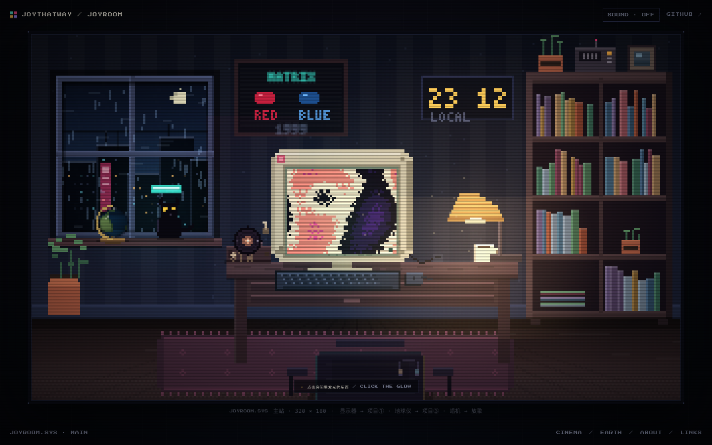

# JOYTHATWAY

**—— 一间开在互联网上的 8-bit 房间。**

[**joythatway.github.io**](https://joythatway.github.io/)

## 这是哪

一台旧电脑、一个书架、一扇下着雨的窗，还有一只趴在窗台上的猫。

房间里的东西都可以点：

- **显示器** → 像素放映室：点开银幕，有 8 卷随机流动的像素画面
- **地球仪** → 像素地球：可以拖着转的小地球，上面钉着几个坐标
- **书架** → 关于我，以及做过的一些东西
- **窗户** → 去外面看看
- **胶片唱机** → 放一首房间里的歌

台灯和猫也可以点。声音默认是关的，点右上角的 `♪ SOUND` 或唱片机才会响。

更多链接，藏在房间的窗户里。

## 关于

- 这里是 Joythatway 的个人主页。
- GitHub：[@joythatway](https://github.com/joythatway)

> 要多想。

---

*纯静态页面，没有账号，也没有第三方统计。*
